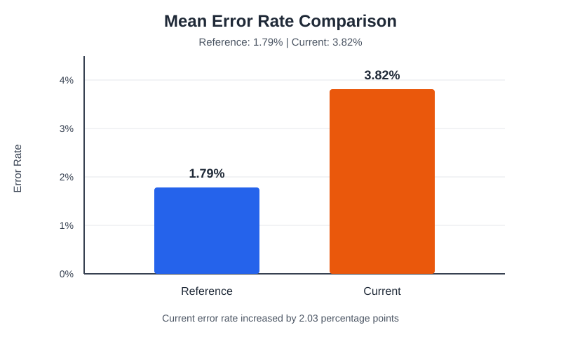

# Detecting Changes in System Behavior

Continuous Intelligence | Project 05 | Custom Report

**Author:** Sandra Otubushin
**Date:** 2026 November

## Overview

This project examines whether recent system behavior differs meaningfully from an earlier reference period.

The analysis uses baseline comparison and drift detection to identify changes in operational metrics that may require investigation.

The custom project focuses on this question:

> Does an increase in errors reflect increased workload, or does it indicate reduced service reliability?

## Data

Two datasets represent different observation periods:

- **Reference data** represents earlier system behavior and provides the baseline.
- **Current data** represents more recent system behavior.

Each dataset contains:

- `requests` - number of requests handled
- `errors` - number of failed requests
- `total_latency_ms` - total response time in milliseconds

The files used in this project are:

- [View Reference Data](https://github.com/sandra8918/cintel-05-drift-detection-custom/blob/main/data/reference_metrics.csv)
- [View Current Data](https://github.com/sandra8918/cintel-05-drift-detection-custom/blob/main/data/current_metrics.csv)

## Methods

The pipeline uses Polars to:

1. Read the reference and current datasets.
2. Calculate summary statistics for both periods.
3. Calculate the difference between current and reference means.
4. Compare differences with configured drift thresholds.
5. Calculate error rates.
6. Save comparison results as CSV artifacts.
7. Record the process in `project.log`.

The difference is calculated as:

```text
difference = current_mean - reference_mean


## Results

| Metric | Reference Mean | Current Mean | Difference | Drift Flag |
|---|---:|---:|---:|---|
| Requests | 128.3 | 164.5 | +36.2 | Yes |
| Errors | 2.3 | 6.3 | +4.0 | No after threshold change |
| Total latency (ms) | 3,835 | 5,670 | +1,835 | Yes |



## Technical Modification

I changed the error drift threshold from **2.0** to **5.0**. I predicted that the error drift flag would change because the observed difference was 4.0. The flag changed from `True` to `False`.

## Service-Reliability Analysis

| Measure | Reference | Current |
|---|---:|---:|
| Observations | 10 | 10 |
| Mean error rate | 1.79% | 3.82% |
| Difference | — | +2.03 percentage points |
| Permutation p-value | — | 0.0002 |

The error rate increased from 1.79% to 3.82%, suggesting possible reduced service reliability—not only increased workload.

## Interpretation

The current period shows higher requests, errors, and latency. These results provide evidence for investigation.

## Limitations

This analysis uses a small synthetic dataset and fixed thresholds. It does not account for seasonality or all sources of variability.

## Conclusion

Combining raw metrics with normalized error rates helps distinguish increased workload from possible service degradation.
